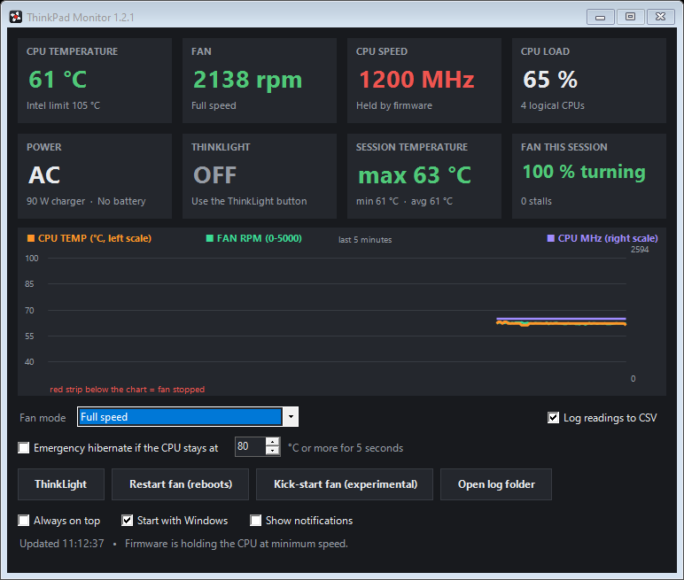

# ThinkPad Monitor

A tiny Windows dashboard + tray app for older ThinkPads that talks **directly to the embedded controller (EC)**,
so it shows what the laptop's firmware actually sees, including the things general-purpose monitors miss:
a fan that has **stopped turning**, and a CPU the firmware is **holding at minimum speed**, with the reason.
It also gives you fan modes, an emergency hibernate, a one-click fan restart and a ThinkLight switch.



Built for a **ThinkPad X230** whose fan bearing was failing and whose keyboard was dead. Nothing else in one place
showed fan stalls, the firmware's speed clamp and a ThinkLight switch at once, so this was written.

- [Quick start](#quick-start)
- [Using it](#using-it)
- [Compatibility](#compatibility)
- [Troubleshooting](#troubleshooting)
- [Uninstall](#uninstall)
- [Build from source](#build-from-source)
- [Extra scripts](#extra-scripts)
- [How it works](#how-it-works)
- [Contributing](#contributing)

## Quick start
1. Download `ThinkPadMonitor-vX.Y.Z-win-x64.zip` from [Releases](../../releases) and extract it anywhere.
2. Run **`InstallDriver.exe`** once and accept the admin prompt. It installs the InpOut port-I/O driver
   (MIT licensed). After this, the app itself needs no admin rights.
3. Run **`ThinkPadMonitor.exe`**.

Requirements: 64-bit Windows 7-11 with .NET Framework 4.x (already part of Windows), and a supported ThinkPad
(see [Compatibility](#compatibility)).

## Using it

### The tiles
| Tile | What it means |
|---|---|
| **CPU temperature** | Read from the EC. Green below 75 °C, amber from 75 °C, red from 90 °C. Intel's limit for these CPUs is about 105 °C. |
| **Fan** | Live RPM from the fan's tachometer. A red **STOPPED** means the tachometer sees no rotation. If the second line says "Commanded: Full speed" at the same time, the fan is being told to spin but isn't, which usually means a seized bearing or a dead fan. |
| **CPU speed** | Current clock. Red with **"Held: ..."** or **"Held by firmware"** means the CPU is at its minimum clock while it is busy (load of 60 % or more): the firmware is holding it down, not normal power saving. "Minimum clock" (amber) at low load is normal. |
| **CPU load** | Total CPU usage across all cores. |
| **Power** | Battery percentage and charging state, or "AC" when no battery is fitted. |
| **ThinkLight** | Whether the ThinkLight (the LED above the screen) is on. |
| **Session temperature** | Highest, lowest and average CPU temperature since the app started. |
| **Fan this session** | Share of the session during which the fan was turning, and how many times it stalled. |

### Why the firmware holds the CPU at minimum speed
The X230's firmware forces the CPU to its low-power speed (1200 MHz on an i5-3230M) under rules of its own, and
Windows only reports "limited by system firmware" (event 37, Kernel-Processor-Power). The app reads the same
EC flags the firmware's rule uses and names the cause in the CPU speed tile and the status line:

| Shown as | Firmware condition |
|---|---|
| **thermal limit** | The EC's thermal flags (`TSL0`) are set: something is too hot, typically because the fan is not moving air. |
| **charger power limit** | The EC's charger flag (`HPLO`) is set while on AC. |
| **N W charger, no battery** | The charger is rated under 90 W and no battery (or only a nearly empty one) is attached, so the firmware will not risk peak load on the charger alone. |

These conditions often last under a second, but the hold stays: Windows keeps the limit it was handed until
the firmware tells it to look again. The tile then says "Held by firmware" and the status line names the last
trigger seen and when.

**The app does not change CPU speed.** It only reports what the firmware is doing. A Windows power-plan limit
cannot lift the firmware's hold (and cannot push the clock below the chip's 1200 MHz minimum either), and these
CPUs cannot be overclocked (locked multiplier). The fix is physical: working cooling, a 90 W charger, or a
battery.

### The graph
The last 5 minutes of CPU temperature (orange, left scale), fan RPM (green, 0-5000) and CPU clock (violet,
right scale). A **red strip** below the chart marks the moments when the fan was not turning.

### Fan mode
| Mode | What the app does |
|---|---|
| **Leave alone (monitor only)** | Default. The app never writes to the fan. |
| **Automatic (firmware)** | Hands the fan to the laptop's own control. |
| **Smart curve** | Level 1 below 56 °C, then levels 3, 5 and 7 at 56, 64 and 72 °C, and full speed from 80 °C. It steps down only once the CPU is 4 °C below a step, so the fan does not hunt. |
| **Full speed** | The fastest the fan can go (faster than level 7). |
| **Level 1-7** | A fixed speed. A fixed low level can overheat the laptop under load: pair it with emergency hibernate. |

The mode is re-applied every second while the app runs. When the app exits it hands the fan back to the
firmware, so the fan is never left pinned at a manual level.

### Emergency hibernate
If the CPU stays at or above the temperature you choose (80-104 °C) for 5 seconds, the laptop hibernates: open
programs are saved to disk and the machine powers off before it can cook. It stays off until you press the
power button. Off until you tick it.

### Buttons
- **ThinkLight**: switches the ThinkLight on or off. No Fn key needed.
- **Restart fan (reboots)**: for a fan the firmware has stopped driving. It restarts Windows (open programs
  close, so save your work first). While the laptop boots, the firmware drives the fan at full power regardless
  of its state, which can get a sticky fan turning again. When the app starts after the reboot (with **Start
  with Windows**, or once by itself if that is off) it holds the fan at full speed for up to 40 seconds and
  reports whether it kept turning. An earlier version used hibernate with a timed wake instead, but timed wake
  from hibernate proved unreliable on the X230.
- **Kick-start fan (experimental)**: cuts the fan's power and restores it in several patterns (about a minute),
  watching the tachometer. On the X230 this was written for, it has **never** been seen to start a stalled fan:
  the EC appears to stop driving a fan it considers failed. It is kept for testing on other models.
- **Open log folder**: opens `Documents\ThinkPadMonitor`, where **Log readings to CSV** writes one line every
  5 seconds (one file per day).
- **Always on top**: keeps the window above other windows.
- **Start with Windows**: starts the app minimized to the tray when you log in.
- **Show notifications**: on by default. Untick it to silence the pop-ups (fan stopped, CPU hot, CPU held at
  minimum speed, fan restart and kick-start results). Emergency hibernate messages always show.

Settings are saved in `%AppData%\ThinkPadMonitor\settings.ini`.

### Tray icon
- The icon shows the **CPU temperature as a number**, coloured like the temperature tile. Its background turns
  **red when the fan is stopped**.
- Hover over it for temperature, fan, clock and load. Left-click to open the dashboard. Right-click for
  ThinkLight, fan mode, Restart fan and **Exit**.
- Closing the window with **X** only hides it to the tray. Use **Exit** in the tray menu to quit.
- You get a pop-up notification when the fan stops or the CPU passes 90 °C (unless **Show notifications** is
  unticked).

## Compatibility
The EC register offsets were read from the X230's own firmware tables and match the ones Linux's `thinkpad_acpi`
uses, so most ThinkPads from roughly 2008-2013 with the classic Lenovo EC probably work. Only one model has
actually been tested so far:

| Model | Windows | Status |
|---|---|---|
| X230 | 10 (64-bit) | Works: all readings and controls verified |

Likely candidates (untested): X200/X201/X220, T400/T410/T420/T430, T500/T510/T520/T530, W5xx.
Newer models (roughly 2014 onwards) use a different EC layout and will probably show wrong values.

**Tried it on another model?** Please [open an issue](../../issues) with your model, your Windows version and
whether the temperature, fan RPM and ThinkLight readings look right. This table will be updated.

## Troubleshooting

**"Windows protected your PC" (SmartScreen) when starting the app.**
The `.exe` is not code-signed, which costs money for a small free project. Click **More info → Run anyway**.
You can check the download against the SHA-256 checksum in the release notes, or build it from source yourself.

**My antivirus flags `InstallDriver.exe` or `inpoutx64.sys`.**
InpOut is a well-known open-source driver that lets programs read and write hardware ports. Because malware can
misuse that kind of access, some antivirus products flag it on principle. It is the same driver used by many
hardware tools. If you are not comfortable with it, do not install it: the app cannot read the EC without it.

**The tiles say "n/a" or "EC unavailable", or the status line says the InpOut driver was not found.**
The driver is not installed or not running. Run `InstallDriver.exe` again and accept the admin prompt. Make
sure `inpoutx64.dll` is in the same folder as `ThinkPadMonitor.exe`.

**CPU speed says "counter unavailable".**
Windows performance counters are disabled or damaged. In an admin command prompt, run `lodctr /r`, then restart.

**The readings look wrong (temperature 0 or 255, nonsense RPM).**
Your model probably uses a different EC layout. Stop using the Kick-start and ThinkLight buttons, since those
write to the EC, and please report the model in an issue.

**The fan shows STOPPED but I can hear it running.**
Some fans have no working tachometer signal. Please report it in an issue together with your model.

**The CPU stays at 1200 MHz.**
That is the firmware's hold (see *Why the firmware holds the CPU at minimum speed*). The app reports it but
cannot lift it.

**Emergency hibernate: the laptop is off and does not come back.**
That is intended: press the power button. Let it cool first.

**Another fan tool (e.g. TPFanControl) is running.**
They can run side by side: both use the shared `Global\Access_EC` lock, so their commands never collide.
But if both try to control the fan, the last one to write wins.

## Uninstall
1. Right-click the tray icon → **Exit**. Untick **Start with Windows** first if you enabled it, or delete the
   `ThinkPadMonitor` value under `HKEY_CURRENT_USER\Software\Microsoft\Windows\CurrentVersion\Run`.
2. Delete the app folder, and `%AppData%\ThinkPadMonitor` (settings) and `Documents\ThinkPadMonitor` (logs)
   if you want those gone too.
3. To remove the InpOut driver as well, run in an **admin** command prompt:
   ```
   sc stop inpoutx64
   sc delete inpoutx64
   del %WINDIR%\System32\drivers\inpoutx64.sys
   ```
   Skip this step if another program uses InpOut.

## Build from source
```
build.cmd
```
Uses the C# compiler that ships with Windows (`%WINDIR%\Microsoft.NET\Framework64\v4.0.30319\csc.exe`).
No Visual Studio needed. Output: `bin\ThinkPadMonitor.exe`, with the InpOut files copied next to it.

Source layout:
| File | Purpose |
|---|---|
| `src/EmbeddedController.cs` | EC read/write over ports 0x62/0x66, with the shared `Global\Access_EC` lock |
| `src/Sampler.cs` | EC register map and one snapshot of every metric |
| `src/PdhCounter.cs` | CPU clock and load via the Windows PDH API |
| `src/FanController.cs` | Fan modes and the smart curve |
| `src/FanKicker.cs` | The experimental fan kick-start sequence |
| `src/PowerPlan.cs` | Hibernate, restart and last boot time |
| `src/Settings.cs` | Saved settings |
| `src/MainForm.cs` | Dashboard window, graph, tray icon, alerts, emergency hibernate and fan restart |

## Extra scripts
PowerShell tools in `scripts/`. Put them next to `inpoutx64.dll` to use them.
- `ThinkLight.ps1 [toggle|on|off|status]`, plus `ThinkLight.vbs` (silent launcher for a hotkey shortcut).
- `FanFull.ps1`: keeps the fan at full speed, re-applied every 5 s, and stands back while the app is
  controlling the fan itself. `-Mode auto` hands the fan back to the firmware, `-Mode status` prints the fan
  register.
- `Install-FanTask.ps1`: registers `FanFull.ps1` as a SYSTEM task at boot, plus a resume-from-sleep trigger
  (run as admin).
- `FanKick.ps1` / `FanKick.vbs`: the kick-start sequence as a standalone script.

## How it works
ThinkPads expose their EC through the standard ACPI EC ports (`0x62` data, `0x66` command/status). The app sends
the standard read (`0x80`) and write (`0x81`) commands through the InpOut driver. Windows' own ACPI driver uses
the same ports, so the status polling is a tight spin loop and every transaction is retried.

The register offsets come from the machine's own ACPI DSDT (`HKLM\HARDWARE\ACPI\DSDT`), whose EC field
definitions name each bit:

| Name in DSDT | EC offset | Meaning |
|---|---|---|
| `TMP0` | `0x78` | CPU temperature, °C |
| `HFSP` | `0x2F` | Fan control: bits 0-2 level, `0x40` full speed, `0x80` automatic |
| `HSPD` | `0x84`-`0x85` | Fan tachometer, RPM (16-bit), `0xFFFF` = not turning |
| `KBLT` | `0x3B` bit 1 | ThinkLight |
| `HPLO` | `0x34` bit 7 | Charger power-limit flag |
| `HWAT` | `0xC9` | Rated watts of the connected charger |
| `TSL0` | `0x88` bits 0-6 | Thermal limit flags |
| `HPAC` | `0x46` bit 4 | Running on the charger |
| `HB0A` / `HB1A` | `0x38` / `0x39` bit 7 | Battery attached |

The throttle rule itself is the `_PPC` method in the `Cpu0Ist` SSDT, which calls `EC.LPMD`.

CPU clock and load come from Windows performance counters via PDH, which keeps working even on machines where
the .NET counter API is broken.

## Warning
This writes to embedded-controller registers. Wrong values can switch off the fan or other hardware.
The offsets are verified for the X230 only, so use it at your own risk on anything else.
A stopped fan is a hardware fault: software can monitor it and limit the damage, but the real fix is cleaning,
lubricating or replacing the fan.

## Contributing
Reports from other ThinkPad models are the most useful contribution: see [Compatibility](#compatibility).
Pull requests are welcome; please keep the app dependency-free and buildable with `build.cmd`.

## License
MIT, see `LICENSE`. InpOut is (c) Phil Gibbons / logix4u.net under the MIT license, see
`third_party/inpout/license.txt`.
